<!--
  GENERATED by `cargo run --release`. Do not edit by hand.
  Edit profile.config.json and regenerate:
      cargo run --release              # refresh GitHub data + rebuild
      cargo run --release -- generate  # rebuild from assets/profile.json
  Last data sync: 2026-11-14T03:02:30Z
-->

 
 
 
 
 

 
 

 

